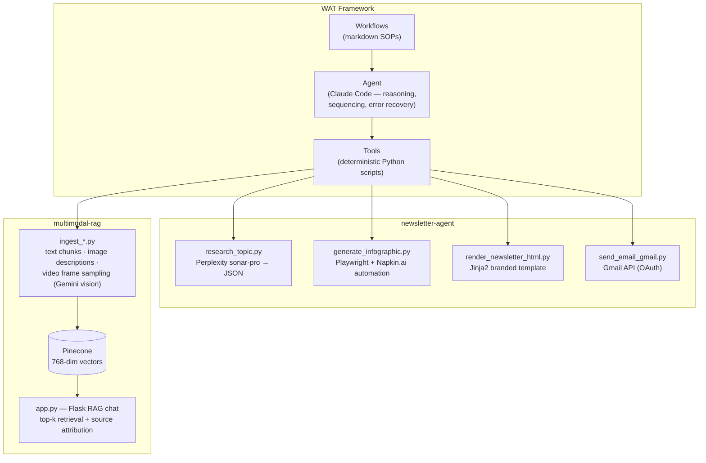

# Agentic Workflows — Autonomous AI Workflow Engine

Autonomous AI agent systems built on the **WAT framework** (Workflows → Agents → Tools): markdown SOPs define *what* to do, an LLM agent (Claude Code) decides *how* to do it, and deterministic Python tools do the actual work. The agent layer handles reasoning and error recovery; the tool layer handles execution — that separation is what keeps multi-step automation reliable.

> If each step of a 5-step pipeline is 90% accurate when the LLM does everything itself, you land at ~59% end-to-end. Pushing execution into deterministic scripts and keeping the LLM in the orchestration seat fixes that.

## Repository layout

```
agentic-workflows/
├── CLAUDE.md            # Agent instructions — how the LLM operates inside WAT
├── newsletter-agent/    # End-to-end autonomous newsletter pipeline
│   ├── workflows/       #   SOPs the agent reads (8-phase newsletter workflow)
│   ├── tools/           #   Deterministic Python tools the agent calls
│   └── examples/        #   Real rendered output
└── multimodal-rag/      # Multimodal RAG chat application (text / image / video)
```

## Architecture



## Subsystem 1 — newsletter-agent

Say *"generate a newsletter about X"* and the agent runs the whole pipeline: research the topic live (Perplexity `sonar-pro`), structure the content as JSON, render a branded HTML email (Jinja2, base64-inlined logo, table-based layout for email clients), generate infographics via Playwright-automated Napkin.ai, and deliver through the Gmail API. The 8-phase SOP lives in [`newsletter-agent/workflows/generate_newsletter.md`](newsletter-agent/workflows/generate_newsletter.md); a real rendered output is in [`newsletter-agent/examples/`](newsletter-agent/examples/).

The same WAT pattern is reused by additional tools in `newsletter-agent/tools/` (automated stock-report and education-report PDF generators) — new capabilities are added as tools, not rewrites.

## Subsystem 2 — multimodal-rag

A working RAG chat application that answers questions over **text, images, and video in one vector space**:

- **Ingestion** — text is chunked and embedded; images get auto-generated descriptions via Gemini vision; videos are frame-sampled (up to 32 frames) and described, then everything is embedded (Gemini `embedding-2`, 768-dim) and upserted to Pinecone.
- **Retrieval** — each chat message is embedded, top-5 nearest items retrieved, and the context assembled with content-type metadata.
- **Generation** — the chat model answers strictly from retrieved context (no general-knowledge fallback), with **source attribution and relevance scores** rendered in the UI.

Setup guide: [`multimodal-rag/SETUP.md`](multimodal-rag/SETUP.md).

## Tech stack

Python · Claude Code (agent layer) · Anthropic API · Perplexity API · Gemini embeddings & vision · Pinecone · Flask · Jinja2 · Playwright · Gmail API (OAuth 2.0)

## Security

All credentials live in `.env` / OAuth token files, which are gitignored. Each subsystem ships a `.env.example` documenting the required keys.

## Author

**Madhav Sharma** — B.Tech CSE (IT), Siksha 'O' Anusandhan · [GitHub](https://github.com/Madhav0414) · [LinkedIn](https://www.linkedin.com/in/madhav-sharma-99a11930a)
